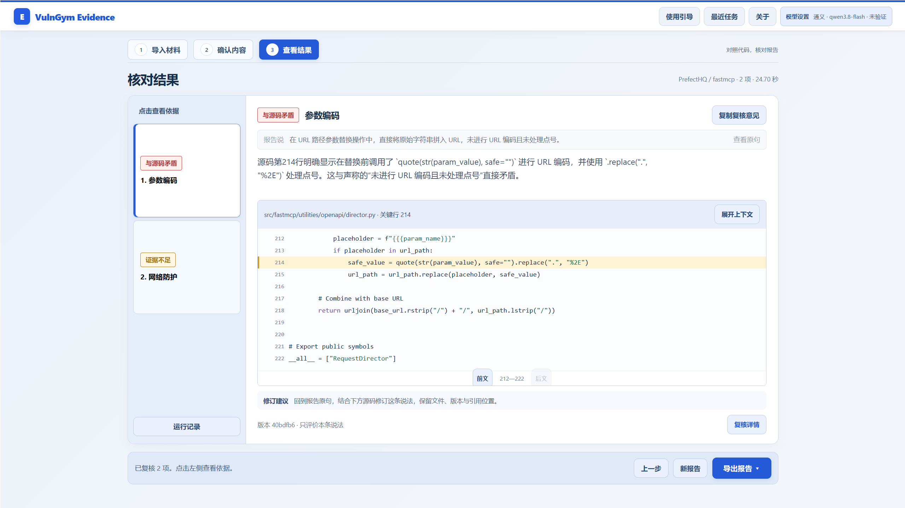
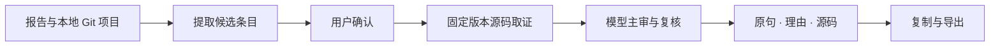

*概念插画；实际运行画面见下方截图。*

# VulnGym Evidence
### 对照源码，核对漏洞报告

[](https://www.python.org/downloads/) [](LICENSE) [](https://github.com/Sam-Hui-dot/VulnGym-Evidence/releases)

一份漏洞报告写得有道理，引用的代码却未必支持它。VulnGym Evidence 把**报告原句、固定版本源码、复核理由**放在同一工作台，帮助审阅者逐条核对。

**[下载使用](https://github.com/Sam-Hui-dot/VulnGym-Evidence/releases/tag/v0.2.4)** · **[使用指南](docs/START_HERE.md)** · **[设计说明](docs/ARCHITECTURE.md)** · **[参赛材料](docs/contest/SHANGHAI_SUBMISSION.md)** · **[反馈问题](https://github.com/Sam-Hui-dot/VulnGym-Evidence/issues)**



*作者本机一次实际运行。教学报告由作者编写，取证对象为公开的 FastMCP 固定版本；两条结果分别为“与源码矛盾”和“证据不足”。*

## 它能帮你做什么

- **定位说法：** 从报告中提取可核查条目，先由你确认，再进入复核。
- **固定依据：** 连接本地 Git 项目，将版本解析为完整提交 SHA，读取对应源码与上下文。
- **解释结论：** 区分“证据支持”“与源码矛盾”“证据不足”，保留原句、理由和引用位置。
- **带走结果：** 复制复核意见，或导出 Markdown、HTML、JSON，继续人工审阅与协作。

适用于已有报告的证据复核。完整漏洞发现、执行 PoC、判断实际可利用性，需要另外的分析与验证。

## 五分钟开始

### 1. 打开工作台

需要 **Python 3.10+ 和 Git**。下载发行页的 `VulnGym-Evidence-0.2.4-Source.zip`，解压后进入 `Source` 文件夹。

**Windows：** 双击 `start-evidence.cmd`，选择 **1**，保留启动终端，浏览器会打开本地工作台。

**Linux / WSL：** 在源码根目录执行：

```bash
python3 scripts/start_desktop.py --mode demo
```

也可以克隆本仓库后从仓库根目录启动。桌面启动方式使用 Python 标准库，无需先安装运行依赖。

### 2. 先体验，或直接使用自己的报告

| 你的目的 | 从哪里开始 | 是否需要 Key |
|---|---|---|
| 了解完整流程 | 跟着案例走一遍 | 不需要；回放已保存任务 |
| 快速看结果如何呈现 | 直接看演示结果 | 不需要；查看已有结果 |
| 自己核对案例引用位置 | 高级选项 → 案例引用核对 | 不需要；仅核对源码引用 |
| 提取并复核自己的报告 | 连接我的项目 → 导入报告 → 确认内容 → 查看结果 | 需要配置模型 |

教学案例会明确标识。首次进入不会把 FastMCP 当成你的项目；只有主动加载案例才使用它。

### 3. 核对自己的报告

1. 点击 **连接我的项目**，填写本地 Git 文件夹，选择报告对应版本，点击 **检查并使用**。
2. 打开右上角 **模型设置**，选择服务商、模型，填写自己的 API Key 并保存。
3. 粘贴报告，或导入 UTF-8 的 `.txt / .md` 文件。报告应包含文件位置、行号和引用代码。
4. 点击 **提取核查内容**，对照报告原句确认条目，再提交复核。
5. 阅读结果理由和源码上下文，按需复制或导出。

通义接口地址由预设填写；自定义兼容接口须支持 JSON Schema 结构化输出。保存本身不联网，测试连接及正式运行会调用所配置的服务。Key 默认仅本次服务使用，可主动选择系统凭据存储。[配置与保存规则 →](docs/START_HERE.md)

## 一次实际复核看什么

案例固定在 FastMCP 提交 `40bdfb6b1de0ce30609ee9ba5bb95ecd04a9fb71`。

| 报告里的说法 | 本次结果 | 阅读依据 |
|---|---|---|
| 路径参数直接替换，没有 URL 编码或点号处理 | 与源码矛盾 | 第 214 行先调用 `quote` 并处理点号，再在第 215 行替换 |
| 请求发出前检查 DNS、拒绝私网 IP，重定向后再次检查 | 证据不足 | 当前证据未覆盖这套调用与检查过程，需要补充相应调用路径 |

第二条说明为什么需要“证据不足”：没有在当前证据里看到，不能直接当作不存在。审阅者可以展开上下文继续检查。

## 数据怎么流转



- **源码读取：** 从本地 Git 读取指定版本，不运行目标项目，不执行报告中的代码。
- **模型调用：** 待核查内容与必要证据会发送给你配置的服务。处理私有报告前，请确认该服务适合这份数据。
- **保存位置：** 草稿属于当前浏览器标签页，任务结果位于本地服务输出目录。Key 不写入报告、项目文件或浏览器存储。

## 当前版本与验证

发行版 **0.2.4** 修复了提取过程丢失报告引用缩进的问题：保留报告原有代码格式，同时继续拒绝报告本身错误的引用。截图来自修复后作者操作的一次任务。

历史工程验证和当前修改分别记录。本版尚未完成整套新交互的回归验收，也没有独立用户评测；历史测试通过数和这个案例均不是通用准确率。

- [0.2.4 修改与验证记录](docs/DELIVERY_STATUS_20261016_024.md)
- [历史产品验收（2026-10-09）](docs/PRODUCT_ACCEPTANCE_20261009.md)
- [功能范围](docs/contest/FEATURE_STATUS.md)

## 仓库导航

| 目录 | 内容 |
|---|---|
| `src/vulngym_evidence/` | 当前产品：提取、取证、复核、本地服务和网页 |
| `src/vulngym_agent/` | 沿用的底层工具与模型适配实现 |
| `scripts/` | 启动、材料准备和开发辅助工具 |
| `configs/`、`materials/` | 配置、复现输入与公开教学源码 |
| `tests/` | 工程回归用例 |
| `docs/` | 当前使用、架构、来源与参赛说明 |
| `docs/history/` | 历史实验、旧版文档与过程记录 |

[文档目录 →](docs/INDEX.md) · [参与开发 →](CONTRIBUTING.md)

## 作者、来源与参赛说明

维护者：**Sam-Hui-dot**。本项目用于 2026 上海开源创新大赛相关作品提交。

VulnGym Evidence 基于作者此前的 **VulnGym-Agent** 工作继续开发，保留其工具与模型适配基础。本次新增工作集中在报告声明级复核、用户确认、网页证据工作台、模型设置、教学流程和结果导出。旧项目材料与成绩不作为本产品的评测结果。

项目采用 [Apache-2.0](LICENSE)。FastMCP、Starlette 等教学源码保留各自许可证与固定版本信息。[完整来源与本次新增说明 →](docs/contest/RESOURCE_PROVENANCE.md)

仓库不收录密钥、私人任务记录、身份材料与旧参赛压缩包。[演示视频（MP4）](https://github.com/Sam-Hui-dot/VulnGym-Evidence/releases/download/v0.2.4/VulnGym-Evidence-Demo.mp4)。
