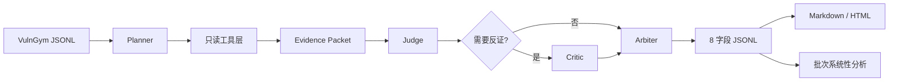

# VulnGym T1 Agent 简明设计说明

## 1. 目标与原则

输入是一条或多条 VulnGym JSONL 候选记录；输出是八个核心字段的三态审核结果、置信度、理由、证据和
可选修正建议。设计遵循三条原则：事实优先由工具证明；模型结论必须可引用；没有证据时允许弃权。

本项目不训练新模型，而是把可插拔 LLM 放入受约束的审核流程。这样更容易更换底层大模型（Backbone），也能在模型
失败、超时或无 Key 时保留确定性检查和明确的 `uncertain`。

## 2. 系统架构

### 工具层

- Schema：检查字段、类型和行号格式；
- Git/Source：只读确认 Commit、文件、行号和代码片段；
- Advisory：读取本地公告缓存中的 CVE/GHSA、版本、标题和 Commit 角色；
- Patch：比较候选版本与可信修复提交，不把任意后继提交当成修复；
- Trace：提取节点函数、顺序、直接调用和未证明边；
- Taxonomy：提供 VulnGym 分类定义，辅助开放式类别判断。

工具不会构建或运行被审核仓库，也不会执行 PoC。

### 语义层

Judge 负责 Entry、Critical、L1、L2、Title 和 Trace 六个开放字段；IDs 与 Commit 主要由确定性证据合并。
每个 `correct/incorrect` 必须引用 Evidence Packet 中存在的 evidence ID，否则本地契约拒绝该输出。

Critic 不是固定的第二次调用。只有整条记录被接受、低置信拒绝或存在高风险分歧时才触发。Arbiter 比较
两轮逐字段结论，阻止低置信 Critic 覆盖更强 Judge，同时完整保留原始输出和取舍理由。

### 输出层

最终输出覆盖 Entry、Critical、L1、L2、Title、IDs、Commit、Trace。任一字段错误则总体为
`incorrect`；无错误但存在证据不足则总体为 `uncertain`。批量运行同时生成：

- `submission.jsonl`：机器可读八字段结果；
- `report.md/.html`：人类可读证据报告；
- `systemic-analysis.json/.md`：跨案例重复问题、案例 ID 和改进建议。

系统性分析只报告“重复信号”，不把统计相关性包装成已经证明的根因。

## 3. 工程与安全设计

- 一条 `validate` 命令串起规划、取证、Judge、Critic、仲裁、报告和反思；
- 每条记录原子写 checkpoint，支持 `--resume` 和只补 Critic；
- Prompt 有 ID、语义版本和 SHA-256；模型、耗时和 Token 均进入运行记录；
- Provider 默认禁止在线请求，必须由本地环境变量显式开启；
- `.env`、密钥、缓存和本地仓库不会进入 Git 或提交 ZIP；
- 缺字段、坏 Commit、公告缺失、模型超时和契约错误均转为可解释失败或 `uncertain`，而不是崩溃。

## 4. 评估方法

评估分为三层：

1. 单元与交付检查：覆盖工具、契约、Provider、恢复、报告和固定产物；
2. 同模型开发对照：同一模型只看裸记录与读取证据时分别检出 9/12、12/12 个预登记错误字段；
3. 冻结运行：预测前冻结案例、参考、配置和哈希，只运行一次并永久保留失败。

Blind v6 为 62/64，10 个预登记错误全部检出；Final Blind v1 扩展到 5 仓库和 Python、TypeScript、Go，
但因八次调用上限只完成 4/5，完整分母为 27/40。两者都不是主办方隐藏集或独立专家 Gold。

## 5. 已知限制

- Trace/helper 是有预算的一跳静态分析，不是完整跨语言污点分析；
- 标题、二级分类和复杂业务逻辑仍受 Backbone LLM 能力影响；
- 当前冻结样本规模有限；
- 模型无固定采样种子，单次 A/B 不能独立证明因果；
- 动态执行只有在主办方提供可信 sandbox 时才适合扩展。

更详细的数据合同和安全边界见 [ARCHITECTURE.md](../ARCHITECTURE.md)，完整指标与失败见
[SELF_EVALUATION.md](SELF_EVALUATION.md)。
