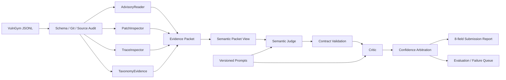

# VulnGym Agent · T1 历史说明

> 从比赛版根 README 移入。文中路径和命令均相对于仓库根目录，历史实验不代表新版结果。

面向 VulnGym 实战课题 T1 的证据优先审计 Agent。它不是重新训练一个通用编码模型，而是把强模型
放进一条可复现、可追责、会主动弃权的漏洞数据验证流水线：确定性工具负责事实，Judge（主审）和
Critic（反证复核）负责开放式安全语义，最终输出逐字段证据报告。

## 评审入口（建议先看）

如果您是第一次打开提交包，建议按以下顺序阅读：

1. [提交总览](../../SUBMISSION_OVERVIEW.md)：两页内了解题目、方案、结果和边界；
2. `VulnGym-T1-Sam-Demo-final.mp4`：3–5 分钟演示（最终提交包中提供）；
3. [简明设计说明](DESIGN_SUMMARY.md)：架构、工具、Prompt/Agent 循环和评估方法；
4. [最终 HTML 报告](../../artifacts/final-blind-v1/report/report.html)：查看逐字段证据与结论；
5. [文档导航](../INDEX.md)：按需审查 AI Coding、Prompt、实验和冻结产物。

长篇研发日志和冻结评测材料属于可追溯附录，不需要顺序阅读。

## 30 秒体验

要求 Python 3.10+，离线演示和测试均不需要安装第三方依赖：

```bash
cd VulnGym-Agent
python3 scripts/show_demo.py
python3 scripts/verify_delivery.py
```

如果终端已经位于项目目录，省略 `cd`。第一条命令回放固定案例，不联网、不消耗模型额度；第二条命令
复核必需材料、冻结产物和完整单元测试。需要从远端获取时：

```bash
git clone https://github.com/Sam-Hui-dot/VulnGym-Agent.git
```

仓库为私有时需要使用已获授权的 GitHub 账号。

<details>
<summary><strong>展开完整能力、评测口径、目录和 AI 辅助开发说明</strong></summary>

以下内容供技术审计使用；快速评审可直接跳到“使用”。

## 当前状态

当前主线已经形成端到端闭环：

- 读取和写出 UTF-8 JSONL；
- 按 VulnGym v0.1.4 Schema 逐字段审计；
- 兼容正整数行号和 `"start-end"` 行号范围；
- 通过只读 Git 命令检查 commit、文件、行号和代码片段；
- 每个结论都输出 `correct / incorrect / uncertain`、置信度、理由和证据；
- 显式保留语义判断的不确定性，证据不足时不让 LLM 假装给出答案；
- 批处理 CLI，以及 `plan -> tools -> reflect` 的最小 Agent 执行骨架；
- 从公开已验证记录构建干净/错误候选样本，并按仓库或报告隔离 train/dev/holdout；
- 使用独立 manifest 记录每个变异的预期错误字段和内容哈希；
- 基础评测器统计错误样本召回、字段错误召回、干净样本准确率和弃权率；
- 多仓库索引器汇总每个上游仓库所需 commit，并区分 missing 与尚未检查；
- Patch Inspector 组合直接子提交与公告显式修复提交，保留来源角色、祖先关系、源码差异和证据等级；
- Evidence Packet 汇总确定性检查、带行号源码上下文和选定修复 diff；
- AdvisoryReader 从离线 GHSA/OSV/规范化 JSON 缓存提取标识、标题、引用和显式 commit 角色；
- TraceInspector 静态提取节点所在函数/代码块，标记直接符号调用、同函数顺序、反向顺序和未证明边；
- 模型无关的 Judge/Critic 契约要求六个语义字段逐项三态判断，并拒绝不存在的证据引用；
- Judge/Critic Prompt 具有稳定 ID、语义版本和内容哈希，结果可追溯到实际 Prompt 文本；
- Codex CLI provider 以 JSONL 事件模式调用模型，记录耗时、Token 用量和线程元数据；
- Judge/Critic 支持逐条原子 checkpoint、`--resume` 续跑和仅补跑 Critic；
- 对“逐字段结论已合法、但 overall 派生值矛盾”提供显式可审计修复，原始模型输出始终保留；
- 语义结果汇总器统计状态、字段结论、Judge→Critic 变化、耗时和 Token 成本；
- 提交适配器输出 T1 的 8 个核心字段，并允许确定性源码反证否决模型结论；
- 字段级语义评测器支持分批结果、Judge/Critic 对比、弃权率和高置信错误分析。
- 一条 `validate` 命令完成资源规划、证据采集、Judge、Critic、置信度仲裁、八字段报告和反思总结；
- 每批 `validate` 自动生成 `systemic-analysis.json/.md`，聚合跨案例重复证据缺口、错误模式、
  Judge→Critic 方向变化和模型契约重试；每项均列出案例 ID，只报告复核线索而不伪造因果根因；
- 同模型“裸记录 vs 证据 Judge vs 完整 Agent”仓库级开发对照，避免拿不同模型制造稻草人基线；
- 语义请求只发送可引用的紧凑证据视图，完整 Evidence Packet 仍落盘审计；
- Critic 低置信反向修改由透明 non-regression gate 拦截，高置信修正仍可进入最终结果。

当前开发版本为 Evidence Packet `0.11.0`、Workflow `0.1.0`、Judge/Critic Prompt `1.7.0`。仓库级开发实验
固定 10 个真实项目、12 个定向错误字段；同一 `deepseek-v4-flash` 裸记录基线检出 9/12，Evidence
Judge 检出 12/12，加入由该组失败推动的仲裁规则后最终为 12/12。该指标只衡量预先记录的变异字段，
不冒充官方隐藏集准确率。紧凑证据视图把完整 Agent 消耗从 650,807 降至 319,784 Token（-50.9%）。
Blind v2 的首次失败和 Blind v3 的证据复核冻结协议分别见 `docs/BLIND_EVALUATION_V2.md` 与
`docs/BLIND_EVALUATION_V3.md`。

## 评测结果与口径

| 阶段 | 结果 | 用途与边界 |
|---|---:|---|
| 同模型仓库级开发对照 | 裸模型 9/12；Evidence Agent 12/12 | 定向变异字段；参与过规则开发，不是盲测 |
| Blind v2 唯一冻结运行 | 59/80（73.75%） | provisional 版本差异参考；用于发现工程失败 |
| Blind v3 唯一冻结运行 | 70/104（67.31%） | 13 条证据复核案例；原始结果不可覆盖，不是官方隐藏集 |
| Post-v3 适配器重放 | 79/104（75.96%） | 复用原模型输出，只证明 Commit 适配器修复，不是新盲测 |
| Post-v3 已见失败定向回归 | 31/32（96.88%） | 4 条已观察失败；证明修复方向，不代表泛化成绩 |
| Blind v6 唯一冻结运行 | 62/64（96.88%） | 8 条未见 entry/report；10/10 错误检出，2 仓库有限验证 |
| Post-v6 provenance 加固重放 | 59/64（92.19%） | 复用冻结模型输出，移除 Commit 循环论证；零模型调用、非新盲测 |
| Final smoke v1 | 21/24（87.50%） | 3 个新仓库的当前版本验收；2 条正例全对，Paperclip 反例暴露 helper 定义缺失 |
| Final Blind v1 | 27/40（67.50%）；已完成 27/32（84.38%） | 5 仓库、3 种语言、5 条冻结记录；8 次物理调用上限内完成 4 条，第 5 条未补跑 |

Blind v3 暴露的核心问题不是隐藏起来的：Commit 适配器对 13/13 条全部弃权，Trace 又把六条可辩护
链路误报为错误，taxonomy 还混淆了 authentication 与 authorization。当前 Packet 0.11.0 / Prompt 1.7.0
已针对这些根因修正，但 Blind v3 不重跑“刷分”。原始哈希、字段 confusion、Token、耗时和后续定向
回归分别保存在 `artifacts/blind-v3/result-summary.json` 与
`artifacts/post-v3-targeted-v14/summary.json`。

Blind v5 后没有覆盖原结果刷分：先修正确定性源码误伤、补全公告获取并预登记选择性 Critic，再用
8 条未见 entry/report 完成 Blind v6 唯一运行。结果为 62/64，incorrect precision / recall 为
90.91% / 100%；剩余两处差异均在开放的 L2 taxonomy 边界。该结果显著支持修复方向，但因仅覆盖
2 个仓库且参考不是独立专家 Gold，仍不冒充官方泛化准确率。

Blind v6 冻结后又发现 Commit 字段存在循环论证风险：仅因候选提交只有一个直接子提交，就可能把后者
当作修复并反推候选为正确。Packet 0.9.0 要求 `verified` provenance 同时具备可信 fix-map 或公告显式
修复角色、候选到修复的 Git 祖先关系，以及可检查的源码差异；普通引用、提交信息和拓扑只作为
`supported/weak` 线索。零模型重放因此将三项 Commit 从 `correct` 改为 `uncertain`，得到 59/64。
冻结的 62/64 不被覆盖，两套结果及边界均可独立复算。

最终验证另外冻结了 5 个此前未进入冻结选择的 entry/report，覆盖 5 个上游仓库及 Python、
TypeScript、Go。Qwen3.8-Flash 的唯一正式运行在 8 次物理调用上限内完成 4/5；已完成字段为
27/32，第 5 条按缺失计入完整分母后为 27/40。该结果不用于继续调参：它既验证了多仓证据流水线和
预算停止机制，也如实保留 2 个高置信误报、3 个 `uncertain` 和 1 条未预测。详见
`artifacts/final-blind-v1/` 与 `docs/COST_AND_LATENCY.md`。

## 架构



组件职责、证据合同和安全边界详见 `docs/ARCHITECTURE.md`。

## 目录

```text
src/vulngym_agent/
  cli.py          批处理命令行入口
  engine.py       规划、工具调用和反思汇总
  models.py       审计结论与证据模型
  repository.py   只读 Git 仓库工具
  schema.py       VulnGym v0.1.4 结构规则
  source.py       文件、行号和代码片段验证
  advisory.py     离线公告事实与 commit 角色
  taxonomy.py     VulnGym 正式分类标签证据
  patch_inspector.py 修复提交对比
  trace_inspector.py Trace 函数上下文与相邻边
  workflow.py      条件规划、端到端执行和反思
  baseline.py      同模型裸记录基线
  benchmark.py     仓库隔离的定向变异基准
  semantic_runner.py Judge→Critic、仲裁与 checkpoint
  submission.py   8 字段最终报告适配
  systemic_analysis.py 批次重复错误模式与证据缺口归因
docs/
  ARCHITECTURE.md 系统架构、数据合同与边界
  DEMO_SCRIPT.md  5 分钟演示与录屏脚本
  SELF_EVALUATION.md 当前指标、对照与限制
  DEFENSE_QA.md   答辩常见问题与一分钟表述
  ROADMAP.md      Top 3 导向的迭代路线
  DECISIONS.md    架构与评测关键决策
  AI_CODING_LOG.md AI Coding 使用与人工复核记录
  PROMPT_HISTORY.md Prompt 版本、变更理由与实验假设
  EXPERIMENT_LOG.md 可复核的实验结果与后续模板
  GOLD_REVIEW_GUIDE.md 独立人工 Gold 的字段口径与复核流程
  REPO_HOLDOUT_EVALUATION.md 仓库级开发对照、成本与边界
  BLIND_EVALUATION_V2.md 冻结盲测协议、完整指标与防泄漏规则
  BLIND_EVALUATION_V3.md 失败驱动修复后的证据复核盲测协议
  BLIND_V3_REVIEW_SHEET.md 13 条案例的逐案字段裁决与依据
  ROBUSTNESS_MATRIX.md 资源、输入、Provider 与恢复路径验收矩阵
  RECORDING_GUIDE.md 3–5 分钟录屏操作、台词和隐私检查
  SUBMISSION_CHECKLIST.md 最终交付物、状态和提交前检查
```

## AI 辅助开发

本项目使用 AI Coding 工具辅助实现、审查和文档整理。AI 的参与范围、主要改动、验证结果与
人工保留的决策记录在 `docs/AI_CODING_LOG.md`；影响系统行为和评测口径的长期决策记录在
`docs/DECISIONS.md`。API Key、访问令牌和私人完整对话不会进入仓库。

语义调用会在结果中保存 `judge_prompt` / `critic_prompt`（Prompt ID、版本和 SHA-256）。
规范 Prompt 与演进理由分别位于 `src/vulngym_agent/prompt_registry.py` 和
`docs/PROMPT_HISTORY.md`，实验结果记录在 `docs/EXPERIMENT_LOG.md`。

Evidence Packet 0.11.0 包含公告事实、VulnGym taxonomy 及公告语义 cross-check、版本与 `trace_analysis`；
并以有界方式补充同文件及一跳静态相对导入 helper 的唯一函数定义。最多检查 24 个候选文件、返回 6 个
helper；重名或歧义时弃权。只有 unresolved 或反向边会附加扩展函数上下文，
已被直接符号调用或同函数顺序解释的边只保留结构化摘要，避免无差别扩大 Token。
Critical Operation 的源码窗口采用前短后长策略，以便呈现调用后的包装、返回和激活阶段；Entry Point
仍保持对称紧凑窗口。该策略用于核验生命周期陈述，不把“构造对象”自动等同于“触发副作用”。

</details>

## 使用

第一次了解项目，可以先运行不联网、不消耗模型额度的两分钟离线演示：

```bash
cd VulnGym-Agent
python3 scripts/show_demo.py
```

它展示一条真实已完成案例的候选说法、关键证据、八字段结论和建议修正。人话版说明见
`docs/QUICK_DEMO.md`。该命令是可追溯结果回放，不冒充一次新的在线 Agent 调用。

无需安装依赖，可以直接从源码运行：

```bash
cd VulnGym-Agent
PYTHONPATH=src python3 -m vulngym_agent audit \
  --input ../VulnGym/data/entries.jsonl \
  --output out/schema-audit.jsonl \
  --limit 5
```

### 完整 Agent 运行

完整在线 Agent 使用一条命令。它会先检查资源缺口，只运行必要工具，并把每条结果原子保存到输出目录：

```bash
PYTHONPATH=src python3 -m vulngym_agent validate \
  --input candidates.jsonl \
  --repositories-root /path/to/upstream-repositories \
  --fix-map configs/repo-holdout-v1-fixes.json \
  --advisory-cache configs/advisories/repo-holdout-v1.jsonl \
  --provider-config configs/provider.deepseek.json \
  --output-dir out/validation \
  --resume
```

千问 `qwen3.8-flash` 也可作为同一 Agent harness 的可插拔语义后端。将
`DASHSCOPE_API_KEY` 仅保存在本地 `.env`，显式启用在线调用后，把上例的 provider
配置替换为：

```bash
--provider-config configs/provider.qwen.json
```

Qwen provider 默认使用标准 OpenAI-compatible Chat Completions 接口及严格 JSON
Schema；默认在线关闭，需设置 `VULNGYM_QWEN_ENABLED=true` 才会发送请求。

输出目录包含 `runs.jsonl`、完整 `evidence.jsonl`、`semantic.jsonl`、八字段 `submission.jsonl` 和
批次 `summary.json`。在线 Provider 默认关闭，必须由操作者通过本地环境变量显式开启；密钥不会写入结果。

完整数据审计需要将官方 VulnGym 仓库放在同级目录：

```bash
cd ..
git clone https://github.com/Tencent/VulnGym.git
cd VulnGym-Agent
```

上面的命令只做 Schema 审计。若本地已有该记录对应的上游源码仓库，可增加：

```bash
--repository /path/to/the/upstream/repository
```

`--repository` 适合输入全部属于同一个上游仓库的快速检查。多仓库批处理使用下文的
`index-repositories` 和 `prepare-evidence --repositories-root`。

构建按仓库隔离的开发数据：

```bash
PYTHONPATH=src python3 -m vulngym_agent build-dataset \
  --input ../VulnGym/data/entries.jsonl \
  --output-dir out/dataset-v1 \
  --split-unit repo \
  --mutations-per-record 3
```

它会生成 `candidates.train/dev/holdout.jsonl`、对应的 `manifest.train/dev/holdout.jsonl`、
全量 `manifest.jsonl` 和 `summary.json`。变异所需的 donor 只从同一个 split 选择，避免内容跨集合泄漏。
评测 Agent 输出：

```bash
PYTHONPATH=src python3 -m vulngym_agent evaluate \
  --audit out/audit.dev.jsonl \
  --manifest out/dataset-v1/manifest.dev.jsonl
```

从 VulnGym 已发布版本的真实修订中提取 before→after 负样本：

```bash
PYTHONPATH=src python3 -m vulngym_agent mine-history \
  --repository ../VulnGym \
  --reference-ref v0.1.4 \
  --candidate-ref v0.1.0 \
  --candidate-ref v0.1.1 \
  --candidate-ref v0.1.2 \
  --candidate-ref v0.1.3 \
  --output-dir out/history-v0.1.4
```

矿工忽略仅修改 `desc` 的文案变化，只把 commit、入口、关键操作、trace、类别、标题和标识等
目标字段的真实修订作为错误标签，并对相同历史候选去重。

生成上游仓库与 commit 资源清单：

```bash
PYTHONPATH=src python3 -m vulngym_agent index-repositories \
  --input ../VulnGym/data/entries.jsonl \
  --repositories-root /path/to/vulngym-repos \
  --output out/repository-index.json \
  --verified-only
```

本地仓库准备好后生成 Evidence Packet：

```bash
PYTHONPATH=src python3 -m vulngym_agent prepare-evidence \
  --input out/pilot-candidates.jsonl \
  --repositories-root /path/to/vulngym-repos \
  --output out/pilot-evidence.jsonl
```

若已有本地公告缓存，可重复指定文件或目录；审计过程本身不会联网：

```bash
PYTHONPATH=src python3 -m vulngym_agent prepare-evidence \
  --input out/pilot-candidates.jsonl \
  --repositories-root /path/to/vulngym-repos \
  --advisory-cache /path/to/advisory-cache \
  --output out/pilot-evidence.jsonl
```

以下命令只用于赛前准备原始公告缓存，不属于正式验证或评分路径，也不产生字段金标。网络访问必须显式
开启；获取器按 GitHub Advisory API、官方公告网页结构化信息、OSV 依次回退。若活动将任一公告 API
视为禁止的“标准答案 API”，请不要运行此命令，直接使用出题方提供的本地缓存。正式审计始终保持离线：

```bash
PYTHONPATH=src python3 -m vulngym_agent fetch-advisories \
  --input out/pilot-candidates.jsonl \
  --output out/pilot-advisories.jsonl \
  --allow-network
```

支持常见 GHSA/OSV 字段和规范化 JSON/JSONL。普通 `/commit/<sha>` 引用只记录为
`referenced_commits`；只有缓存明确提供 `vulnerable_commits` / `fixed_commits` 时才赋予角色。
仓库内的 `configs/advisories/pilot-v1.jsonl` 是五条 Pilot 的可复现公开证据缓存，并保留 commit
角色的验证依据。

首批案例在 `configs/pilot-cases.json`；研发早期的资源假设保留在 `docs/RESOURCE_REQUESTS.md`，仅作过程
留痕，不代表当前交付仍被这些问题阻塞。

把首批 entry 从完整数据集中取出：

```bash
PYTHONPATH=src python3 -m vulngym_agent select-cases \
  --input ../VulnGym/data/entries.jsonl \
  --selection configs/pilot-cases.json \
  --output out/pilot-candidates.jsonl
```

模型 wrapper 需要从 stdin 读取一份 Judge/Critic 请求，并向 stdout 只写一份符合契约的 JSON 对象。
配置格式见 `configs/provider.example.json`。接好后运行：

```bash
PYTHONPATH=src python3 -m vulngym_agent run-semantic \
  --evidence out/pilot-evidence.jsonl \
  --provider-config configs/provider.local.json \
  --output out/pilot-semantic.jsonl \
  --resume
```

批量运行建议使用 `--critic-policy review-risk`：整条被 Judge 接受或出现低置信拒绝时才追加 Critic；
`always` 保留旧的全量双阶段行为，`never` 等价于 Judge-only。证据不足导致的 `uncertain` 不会单独触发
第二次模型调用，因为重复发送同一证据无法补回缺失事实。

执行器会先验证 Judge 输出，再发起 Critic；任一阶段引用未知 evidence ID、字段缺失、总体结论与
逐字段结论冲突，都会作为 contract error 保留，不能悄悄进入最终结果。

`--resume` 会复用已完成记录，并在每条完成后原子写入 checkpoint。若 Judge 已经完成而 Critic
中断，可仅补跑 Critic：

```bash
PYTHONPATH=src python3 -m vulngym_agent run-critic \
  --evidence out/pilot-evidence.jsonl \
  --judgments out/pilot-judge.jsonl \
  --provider-config configs/provider.codex-cli.json \
  --output out/pilot-complete.jsonl \
  --resume
```

### 使用 OpenRouter / OX Alpha

Judge/Critic 不绑定 Codex。仓库内置 OpenRouter Provider。OX Alpha 测试期结束后，OpenRouter API
明确将其公开为 Z.ai GLM-5.3 Flash，因此默认模型为正式 ID `z-ai/glm-5.3-flash`。先复制
`.env.example` 为本地 `.env`，填入新建的 OpenRouter Key；`.env` 已被
Git 忽略，真实 Key 不得进入仓库、截图或日志。加载环境后运行：

```bash
set -a
source .env
set +a
PYTHONPATH=src python3 -m vulngym_agent run-semantic \
  --evidence out/pilot-v1/evidence-advisory-facts-v2.jsonl \
  --provider-config configs/provider.openrouter.json \
  --output out/openrouter-ox-alpha-smoke.jsonl \
  --limit 1
```

可用 `VULNGYM_OPENROUTER_MODEL` 切换模型，不改 Agent 主流程。该 Provider 要求模型支持严格结构化
JSON；换模型后必须先做小样本契约和效果回归。原 OX Alpha 是匿名预览服务，其测试期说明称上游会
保留提示词和输出；本项目仍只发送公开漏洞材料，不发送密钥、私人仓库或未公开漏洞。

### 使用 DeepSeek API

DeepSeek Provider 使用官方 Responses API。V4-Flash 的结构化输出直接接收完整 JSON Schema；返回
结果仍会经过本地语义契约校验，模型不能绕过 evidence ref、字段完整性和总体结论约束。结构化 Judge
默认关闭 DeepSeek 思考模式以控制 Token；复杂案例可临时设置
`VULNGYM_DEEPSEEK_REASONING_EFFORT=high`，再由独立 Critic 做第二轮反证。适配器已验证
`deepseek-v4-flash` 与 `deepseek-v4-pro` 的 Responses API 结构化输出；换模型或思考强度后仍须先做
小样本效果回归。

将 `.env.example` 中的 DeepSeek 变量复制到本地 `.env`，填入新建的 DeepSeek Key，并保持
`VULNGYM_DEEPSEEK_ENABLED=false`。需要在线运行时只为当前命令临时设置为 `true`。先用单条 Judge
烟测：

```bash
set -a
source .env
set +a
VULNGYM_DEEPSEEK_ENABLED=true PYTHONPATH=src python3 -m vulngym_agent run-semantic \
  --evidence out/pilot-v1/evidence-advisory-facts-v2.jsonl \
  --provider-config configs/provider.deepseek.json \
  --output out/deepseek-smoke-judge.jsonl \
  --entry-id entry-00080 \
  --no-critic
```

确认结构、证据引用和用量正常后，再去掉 `--no-critic`。模型和思考强度都属于实验变量，应在固定
样例上比较后再冻结，不应只凭单次输出选择。

汇总一个或多个批次：

```bash
PYTHONPATH=src python3 -m vulngym_agent report-semantic \
  --input out/pilot-a.jsonl \
  --input out/pilot-b.jsonl \
  --output out/pilot-report.json
```

有独立人工 gold 后，评估 Judge、Critic 与字段级失败；分批结果可重复传入 `--semantic`：

```bash
PYTHONPATH=src python3 -m vulngym_agent evaluate-semantic \
  --semantic out/pilot-complete.jsonl \
  --semantic out/pilot-retry.jsonl \
  --gold configs/semantic-gold.dev.jsonl \
  --output out/semantic-evaluation.json
```

Gold 格式和复核口径见 `docs/GOLD_REVIEW_GUIDE.md`；`configs/semantic-gold.example.jsonl`
仅是结构示例，不是实际答案。评测器会报告字段混淆矩阵、弃权率、incorrect precision/recall、
高置信错误、案例严格匹配以及 Critic 相对 Judge 的准确率变化。

冻结的八字段 Blind v2 不复用上述开发案例。先从 VulnGym 已发布版本确定性物化候选与 provisional
reference，再评估最终 `submission.jsonl`：

```bash
PYTHONPATH=src python3 -m vulngym_agent build-blind-dataset \
  --repository ../VulnGym \
  --selection configs/blind-v2-selection.json \
  --output-dir out/blind-v2

PYTHONPATH=src python3 -m vulngym_agent evaluate-submission \
  --submission out/blind-v2-run/submission.jsonl \
  --reference out/blind-v2/reference.jsonl \
  --output out/blind-v2-run/evaluation.json
```

协议、冻结边界和指标口径见 `docs/BLIND_EVALUATION_V2.md`。模型运行后不得针对同一组调参并继续称其
为盲测；独立复核完成前，reference 不称专家 Gold。

Blind v2 失败驱动修复后的 Blind v3 使用未见 entry/report、完整证据复核标签与新的冻结哈希：

```bash
PYTHONPATH=src python3 -m vulngym_agent build-blind-dataset \
  --repository ../VulnGym \
  --selection configs/blind-v3-selection.json \
  --output-dir out/blind-v3
```

Blind v3 的公开数据边界、104 字段标签组成和单次运行规则见 `docs/BLIND_EVALUATION_V3.md`。

将 Evidence Packet 与 Judge/Critic 结果合并为 PDF 示例风格的 T1 逐字段报告：

```bash
PYTHONPATH=src python3 -m vulngym_agent build-submission \
  --evidence out/pilot-evidence.jsonl \
  --semantic out/pilot-complete.jsonl \
  --output out/submission.jsonl
```

若语义结果分批保存，可重复传入 `--semantic`；相同 `entry_id` 以后出现的记录为准。

提交适配层当前覆盖 `entry_point`、`critical_operation`、两级漏洞分类、`vuln_title`、
`vuln_ids`、`commit` 和 `trace`。确定性源码检查可以否决模型的错误结论；当前 Evidence Packet
未覆盖的字段会明确输出 `uncertain`，不会仅凭格式正确假装语义已经验证。相同 `entry_id` 的结果以后出现者
覆盖较早 checkpoint，便于补跑后统一汇总。

若模型唯一的契约错误是 `overall_verdict` 与五个合法字段结论不一致，可离线执行
`repair-semantic`。该操作只重算派生值，并同时保存 raw output、修复内容和修复前后验证结果，
不会改写任何字段的语义判断。

输出每行对应一条输入记录，例如：

```json
{
  "entry_id": "entry-00057",
  "overall_verdict": "uncertain",
  "confidence": 0.5,
  "plan": ["validate_schema", "resolve_repository", "inspect_git_objects", "reflect"],
  "summary": {"correct": 20, "incorrect": 0, "uncertain": 4},
  "checks": []
}
```

未提供源码仓库，或尚需 LLM 判断语义时，结果会如实标为 `uncertain`。这不是失败，
而是 T1 所要求的三态判断和低幻觉策略。

## 安全边界

仓库工具只执行 `git cat-file` 和 `git show` 等读取操作，不 checkout，不运行被审计仓库中的程序，
也不在评测时联网抓取内容。
